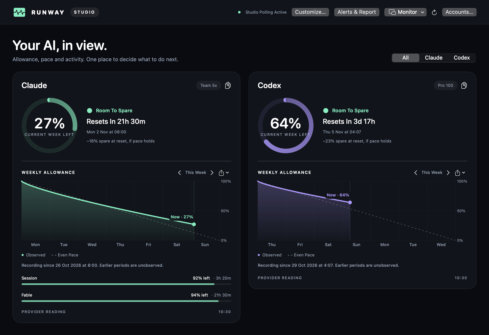
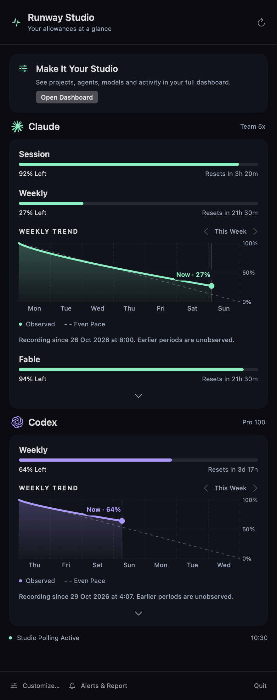
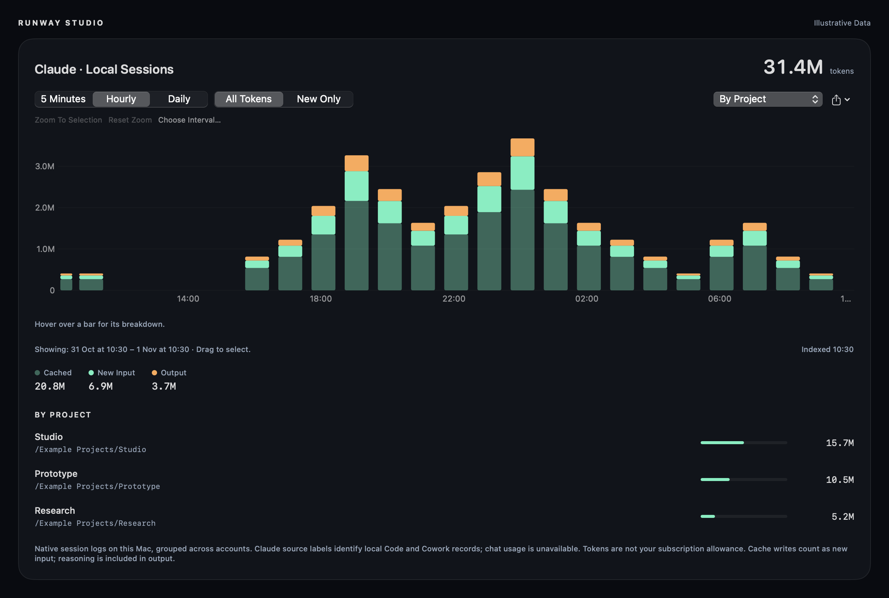

# Runway Studio

A native macOS menu bar app and dashboard for **Claude and Codex**—with weekly allowance curves, local activity breakdowns, alerts and a morning report.

Studio began as a fork of **[Runway by Matt Stallone](https://github.com/mstallone/runway)**, itself derived from **[OpenUsage by Robin Ebers](https://github.com/robinebers/openusage)**. It retains their MIT provider foundation and adds a substantially redesigned interface and local monitoring workflow. **[Agent Runway by Matt Maher](https://runway.metal-sole.com/)** inspired several features and interaction patterns; it is a separate product, not a source-code ancestor. See [acknowledgements](ACKNOWLEDGEMENTS.md).

<p align="center">
  
</p>

*Rendered from Studio’s actual SwiftUI views using illustrative data. Screenshots do not contain personal usage, credentials or project names.*

## The Studio experience

**Start in the menu bar.** Traffic-light cells and percentages show your remaining allowance. Click for the scrollable dropdown: session and weekly limits, full-week graphs, renewal countdowns and past observed weeks. The dashboard is there when you want more detail.

**Explore your activity.** Five-minute, hourly and daily charts separate cached reads, new input and output. Select or zoom into an interval, then see the matching projects, worktrees, models, main agents and subagents. Token activity is local to this Mac; it is separate from account-wide subscription allowance.

**Let Studio keep watch.** One polling coordinator handles both automatic and manual checks, with persistent backoff and clear freshness labels. Allowance-drop, recovery and reset-credit alerts sit alongside a configurable morning report, defaulting to 07:00 London time.

| Area | What Studio adds or changes |
| --- | --- |
| Interface | Dark mint/violet dashboard, rich menu-bar dropdown, compact floating monitors and saved display choices |
| Weekly history | Shaded allowance curves, daily guides, latest-reading markers and observed-week navigation in both main surfaces |
| Local activity | Interval selection and zoom; project/worktree, model, source and agent breakdowns |
| Alerts | Independent drop rules, recovery/reset events, expiry reminders, local alert history and morning reports |
| Refreshing | Standalone in-process provider checks, one persisted schedule, retry backoff and refresh-health cards |
| Sharing and tools | PNG/text summaries, a read-only statusline, bounded allowance wait and stdio MCP |

The provider clients, auth stores, normalized metrics, pricing and incremental log-parser foundations come from the MIT base. Studio extends and reuses them rather than claiming those capabilities as new work.

### Menu bar dropdown

Weekly graphs stay in the dropdown—you do not need to open the dashboard to check the trend. The panel scrolls on smaller screens.

<p align="center">
  
</p>

*Illustrative dropdown content shown in a taller viewport to reveal both provider cards.*

### Activity by project, model and agent

<p align="center">
  
</p>

## Build and run

Requires **macOS 15 or newer** and **Xcode with Swift 6.2 or newer**. Sign in through Claude Code and Codex on this Mac; Studio reuses those local sign-ins. **The original Runway app and helper are not required.**

```sh
bash script/build_studio.sh
open "dist/Runway Studio.app"
```

For everyday use, copy the built app from `dist/` to Applications. Keep other usage trackers closed so they do not compete for the same provider endpoint. Studio does not need administrator or App Management permission. Protected Keychain credentials can still require connection attention; background checks never prompt for a password.

```sh
swift test -c release --filter 'RunwayStudioTests|RunwayStudioToolsTests|UsageReaderTests|ActivityMetadataTests|ClaudeLogUsageScannerTests|CodexLogUsageScannerTests'
```

Optional CLI/MCP installation, after copying the app to Applications:

```sh
bash script/install_studio_tools.sh
runway-studio statusline
```

This private repository is a source backup. There is no Studio public installer, notarized release or automatic update feed configured. The inherited upstream release workflows are disabled on GitHub.

## Data and scope

- Studio focuses on **Claude and Codex on one Mac**. Cross-device sync and the inherited iOS companion are outside this product’s scope.
- Allowances describe the provider account. Local session logs describe work recorded on this Mac. Tokens do not convert directly into subscription allowance.
- Dollar amounts are **estimated API value**, not your subscription bill. Missing data and incomplete pricing stay labelled.
- Claude Code and supported Cowork logs can be indexed; Claude Chat/Desktop Chat activity is not available from these sources.
- Credentials and runtime history are not committed to this repository. Studio stores its own cache, history and preferences under `~/Library/Application Support/RunwayStudio/`.
- An optional one-time import preserves user-owned Agent Runway allowance history in a separate local archive. Imported account identity is not silently equated with Studio identity.

## Documentation

- [Studio guide](docs/studio.md): setup, menu bar, dashboard, history, alerts and polling
- [CLI and MCP](docs/studio-tools.md): read-only integrations
- [Feature comparison and implementation provenance](docs/agent-runway-comparison.md)
- [Architecture](docs/architecture.md), [contributing](CONTRIBUTING.md) and [security](SECURITY.md)
- [Documentation index](docs/README.md): Studio guides plus clearly separated inherited reference material

The upstream provider modules and older reference assets remain in the source tree. Their presence does not mean Studio exposes every upstream provider, iOS feature or UI.

## Credits and licence

Thank you to **Matt Stallone and the Runway contributors**, **Robin Ebers and the OpenUsage contributors**, and **Matt Maher for Agent Runway’s feature inspiration**. The source lineage is **OpenUsage → Runway → Runway Studio**; Agent Runway is a separate reference product.

The original [MIT licence](LICENSE) and copyright notice are retained. [Acknowledgements](ACKNOWLEDGEMENTS.md) distinguish reused code, Studio changes and inspiration. Studio is not endorsed by the upstream authors or Agent Runway.
